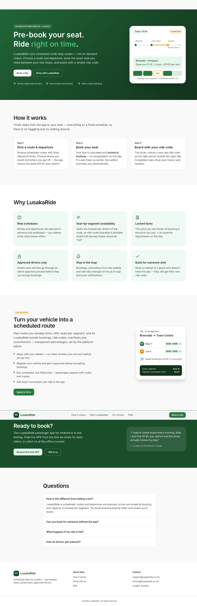
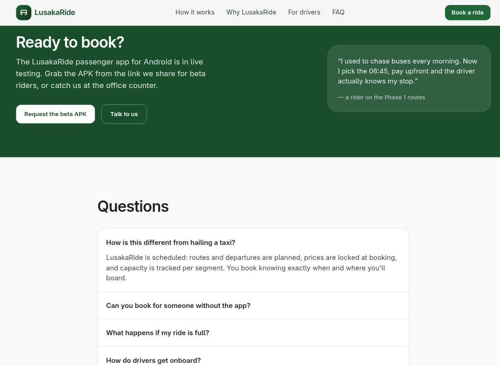

# ui-ux-audit

An **adaptive, evidence-gated UI / UX / flow auditor** as a skill: it reviews
interfaces — screens, components, and whole flows — and flags concrete issues
with citations, calibrated severities, and actionable fixes. It is built to
*accumulate knowledge*: every real audit grows its rule base, so the skill
gets sharper with use.

Works on **any frontend stack**, with first-class defect signals for
**Flutter** and **React/TypeScript** (the stacks it was exercised on).

## What it flags (rule families)

| Domain | Examples |
|---|---|
| **C — reuse** | inline-defined components that should be shared/reusable; dead widget copies; copy-pasted style literals |
| **L — layout** | spacing-rhythm breaks; fixed sizes that clip content; density above the app's class; misaligned siblings; responsive breakage at realistic widths |
| **V — visibility** | contrast below WCAG thresholds; **state holes** (no loading/empty/error/retry branch); icon-only controls without labels; missing affordances |
| **P — positioning** | unbounded overlay panels (the classic "giant dropdown" bug class); sticky-bar collisions; z-order traps |
| **T — touch targets** | the WCAG 2.2 *relational* rule (24css px floor + spacing, no overlapping activation zones; 44pt/48dp kept as the practical recommendation); in-motion sizing for driver-class apps |
| **A — accessibility** | color-only status signaling; broken semantics/order; invisible or trapped focus; motion without reduced-motion guards |
| **F — flow** | entry-point gaps; dead-end screens; inconsistent back behavior; irrevocable actions without confirm; cross-screen object confusion |
| **W — copy** | generic error copy where a specific reason existed; terminology drift across screens and apps |
| **X — suite** | sibling-app consistency under a declared design-system policy (token drift, component parity, cross-app language), and **class-fit deviations** — the system misbehaving for its own class |

Full list: [`knowledge/checks.csv`](knowledge/checks.csv) — including sources.

## The core mechanisms

### 1. Evidence gates (no vibes)

Every finding carries a tier, and severity is **capped by tier**:

```
T0s on-screen (screenshot of the running UI)  → can be Blocker
T0m measured  (DOM/spacing/contrast tools)    → Major+
T1  code      (file:line, construct confirmed) → Blocker only if unguarded by construction
T2  inferred  (pattern heuristic)             → Minor/Probable only, never a Blocker
```

See [`references/severity.md`](references/severity.md). Greps generate
hypotheses; reports cite confirmed evidence only.

### 2. Fitness-to-class (multi-dimensional system classification)

Before any rule applies, the skill **fingerprints the system** — surface,
app-kind, suite membership and design-system policy (unified / themed-variants
/ independent), audience, input, motion tolerance — then audits for *fitness
to that class* ([`knowledge/system-classification.md`](knowledge/system-classification.md)).
The same pattern is a flag in one class and correct in another: dense tables
are the point in an admin console and a defect in a driver app used in
motion.

### 3. Profiles (calibration, not excuses)

`knowledge/profiles.md` defines app-kind profiles — e.g. **driver-glance**
(tightened: ≥48dp in-motion targets, glare-checked contrast, no dead ends) vs
**admin-data-dense** (relaxed density; tightened theme hygiene) — with
explicit tightened/relaxed rules and exception lines.

### 4. The adaptive loop (knowledge increments)

```
audit → journal (findings + any NEW recurring defect class, or user correction)
      → promote/correct/supersede rules in checks.csv (stable IDs)
      → profile exceptions recorded
      → git commit per step (history is the audit trail)
```

Installed users get the **shipped base** and adapt their copy via an
**override layer** (`knowledge/overrides.md`): `disable` / `override` /
`exempt` / `new-rule` entries that survive upstream skill updates. Authors
correct the base through `journal.md` supersedes — nothing is silently
rewritten.

### 5. Flow analysis (not just screen nitpicks)

[`references/flow-protocol.md`](references/flow-protocol.md): enumerate entry
points (first-run, deep links, notifications, error routes) → draw the flow
graph → trace *perturbations* (it's full, session breaks, network breaks, back
mid-flow, expiry) → produce a **state-coverage matrix**
(loading/empty/error/retry/stale/success/undo) → findings cite the edge or
matrix row, not just a screen.

### 6. Supporting instruments

- **Wireframe extraction** (`references/wireframe.md` +
  [`scripts/wireframe.py`](scripts/wireframe.py)): DOM bounding-rect JSON →
  ASCII wireframe for layout-choice critique. Supporting tier for layout
  findings; screenshot-read method for non-DOM surfaces (Flutter).
- **MCP instruments, when connected**: `better-design`'s measured-spacing /
  copy-rule tools are used if present, silently skipped if not.

## Example evidence captured by this skill

Full-page capture of a production marketing site (visual T0s evidence), and a
scrolled-viewport capture proving the sticky header renders correctly where a
full-page stitch had misrepresented it — the two tiers doing their job:

| Full-page capture | Viewport verification |
|---|---|
|  |  |

## Usage

Install the folder as a Claude/OpenCode skill (`~/.opencode/skills/ui-ux-audit/`
or your harness's skill directory). Then:

- *"Audit the booking flow in the passenger app"* → full flow protocol
- *"Review this screen before we ship"* → evidence sweep + rule application
- *"What's wrong with this admin table?"* → profile-calibrated screen audit
- *"Check both sibling apps stick to the unified theme"* → suite rules X-1..X-3

Reports are markdown (finding ID · severity · rule · evidence · fix ·
coverage · *patterns for the KB*) + a machine-readable JSON in the target
repo's `audits/` folder for trend tracking.

## Status & roadmap

- v1.1 — system fingerprint + suite rules; override layer; wireframe script
  (DOM); consent protocol; multi-size evidence (L-5 `candidate`).
- Staged: Flutter widget-tree wireframes (automated); more public-exemplar
  calibration audits; trend dashboards over `audits/*.json`.

## License

MIT — see [LICENSE](LICENSE).
